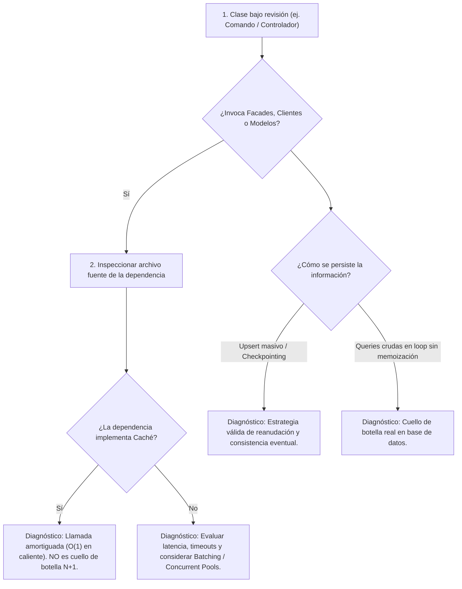

# Protocolo de Revisión de Código y Auditoría Técnica en Laravel

Este documento define la metodología obligatoria para auditar código en aplicaciones Laravel. Su objetivo es garantizar revisiones profundas, objetivas y fundamentadas en la arquitectura real del proyecto, eliminando conclusiones superficiales o falsos positivos.

---

## 1. El Principio de Verificación de Dependencias (Trace Before Judging)

Al evaluar cualquier clase (Comandos de consola, Controladores, Jobs o Actions), el auditor de código **NO puede limitarse al archivo bajo revisión**. Debe construir el grafo de dependencias ejecutando lecturas explícitas:

---

## 2. Matriz de Evaluación: Falso Positivo vs Problema Real

| Patrón Observado | Juicio Superficial (INCORRECTO) | Juicio Senior Contextual (CORRECTO) |
| :--- | :--- | :--- |
| **Llamada a Facade dentro de un bucle** (ej: `LastFm::getTrackInfo()`) | *"Cuello de botella de red N+1 crítico."* | **Revisar el cliente:** Si el cliente usa `Cache::rememberForever()` o Redis, las peticiones repetitivas responden desde memoria local sin latencia de red. |
| **Ausencia de `DB::transaction()` en ingesta de APIs externas** | *"Falta de atomicidad e inconsistencia de datos."* | **Evaluar estrategia de fallo:** En llamadas a APIs externas lentas o inestables, una transacción rígida descarta todo el progreso ante un fallo al 95%. La persistencia por hitos (checkpointing) permite reanudar sin perder llamadas previas. |
| **Consultas de Eloquent en un loop** | *"Problema N+1 inaceptable."* | **Revisar memoización:** Si la clase usa mapas en memoria (`$this->idMap[$key] ??= ...`) para resolver entidades una sola vez por corrida, no hay N+1 en ejecuciones recurrentes. |
| **Comando Artisan de más de 200 líneas** | *"Código totalmente roto y mal diseñado."* | **Distinguir:** Si la lógica funciona y está bien memoizada, el problema no es de rendimiento sino de **acoplamiento arquitectónico** (debe sugerirse extraer a una Action o Service, pero no descalificar la lógica de datos). |

---

## 3. Escala de Calificación Objetiva (Cómo calcular el porcentaje)

Al calificar un módulo de código de 0 a 100%, utilizar el siguiente desglose ponderado:

1. **Rendimiento y Eficiencia de I/O (30%):**
   - ¿Usa `upsert` o inserciones masivas en vez de `save()` fila por fila?
   - ¿Tiene capa de caché en operaciones costosas?
   - ¿Evita cargar colecciones completas en memoria con `cursor()` o `chunkById()`?
2. **Resiliencia y Manejo de Errores (25%):**
   - ¿Qué pasa si la red o la base de datos fallan a mitad de camino?
   - ¿El proceso puede reanudarse de forma idempotente sin duplicar registros?
   - ¿Captura excepciones específicas y las registra en logs?
3. **Arquitectura y Mantenibilidad (25%):**
   - ¿Respeta la responsabilidad única (Single Responsibility Principle)?
   - ¿La lógica es reutilizable desde la web (Inertia), APIs o Jobs?
   - ¿Utiliza tipado estricto (`declare(strict_types=1);`, tipado de argumentos y retornos)?
4. **Seguridad y Convenciones del Framework (20%):**
   - ¿Usa el método `casts()` moderno en modelos?
   - ¿Valida entradas mediante `FormRequest` o reglas estrictas?
   - ¿Cumple con el estándar de formato oficial (Laravel Pint / PSR-12)?

---

## 4. Checklist Obligatorio Antes de Entregar una Revisión

Antes de emitir una crítica o sugerir refactors al usuario:
- [ ] ¿Abrí e inspeccioné los clientes HTTP o servicios llamados por el código?
- [ ] ¿Verifiqué si existe una capa de caché (`Cache::rememberForever`, etc.)?
- [ ] ¿Analicé la telemetría real (logs, `DB::listen`, contadores de llamadas)?
- [ ] ¿Entendí el motivo por el cual el autor diseñó el flujo de esa forma antes de calificarlo como error?
- [ ] ¿Mi recomendación preserva la capacidad de reanudar el proceso en caso de fallos de red?
