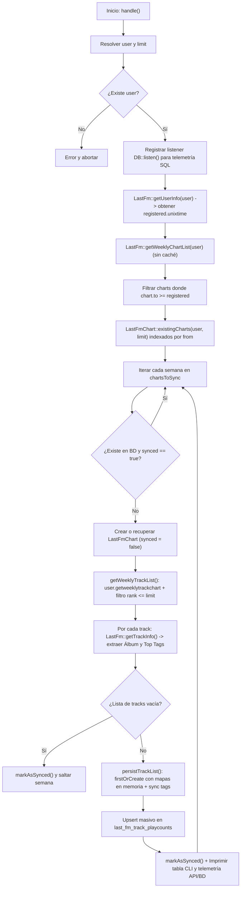
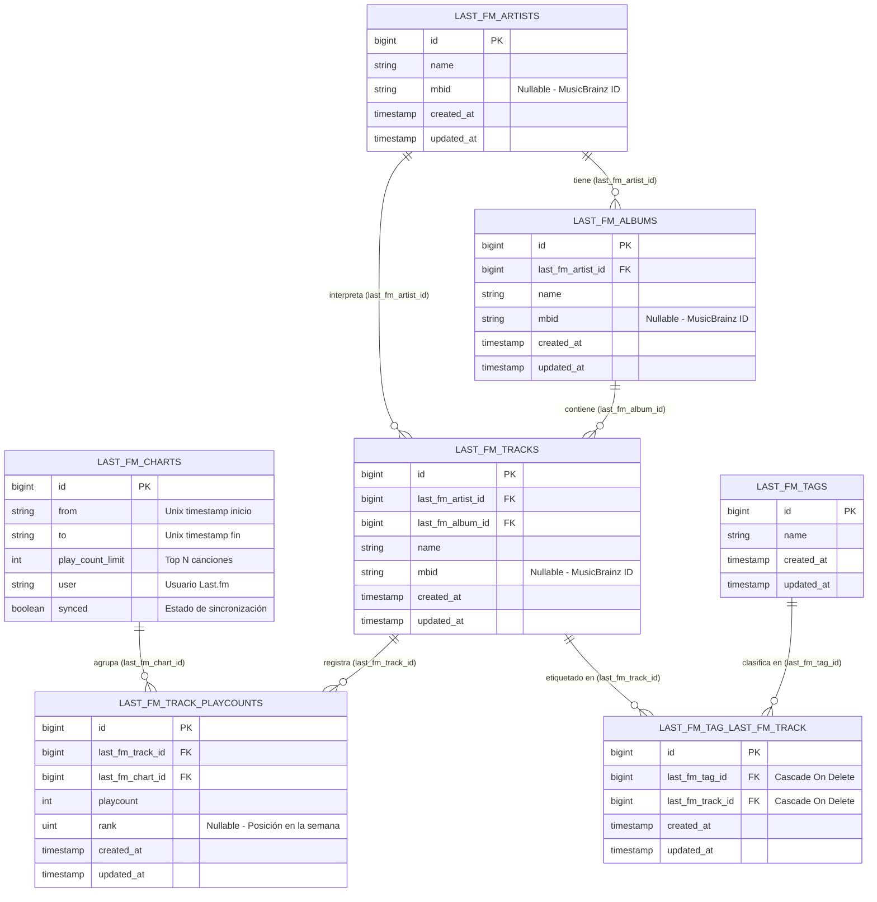
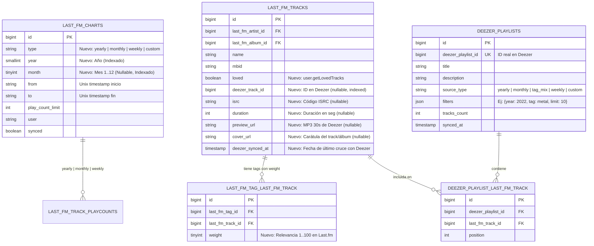
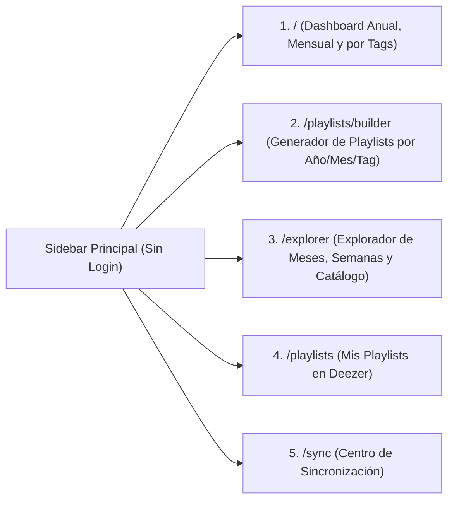

# LastFM v3 — Documentación Técnica y Modelo de Datos

Aplicación construida sobre **Laravel 13 (PHP 8.3+)** orientada a la extracción, enriquecimiento y persistencia local del historial de reproducción semanal (*weekly track charts*) de **Last.fm**, con soporte para caché persistente de respuestas de API, deduplicación en memoria y métricas de rendimiento (API + SQL).

---

## 1. Análisis Técnico de `LastFmSyncWeekly`

**Archivo:** [`app/Console/Commands/LastFmSyncWeekly.php`](file:///Users/felipegaitan/projects/laravel/lastfm_v3/app/Console/Commands/LastFmSyncWeekly.php)

### 1.1 Definición y Firma del Comando
El comando utiliza atributos nativos de PHP 8 / Laravel 13 para declarar su firma y descripción:

```php
#[Signature('lastfm:sync-weekly {user?} {--limit=}')]
#[Description('Sync weekly data from Last.fm')]
```

- **`{user?}`** *(opcional)*: Nombre de usuario en Last.fm. Si se omite, se resuelve mediante `LastFm::getDefaultUser()` (`config('services.lastfm.user')`, por defecto `'svigle'`).
- **`{--limit=}`** *(opcional)*: Cantidad máxima de canciones (*top ranks*) a sincronizar por semana. Si se omite, toma `config('services.lastfm.top_songs')` (por defecto `20`).

```bash
# Ejecución con valores por defecto
php artisan lastfm:sync-weekly

# Ejecución especificando usuario y límite de top canciones por semana
php artisan lastfm:sync-weekly svigle --limit=50
```

---

### 1.2 Estructuras de Caché en Memoria (Memoización en Tiempo de Ejecución)
Para evitar el problema $N+1$ contra la base de datos al procesar cientos de semanas donde los mismos artistas, álbumes, canciones y etiquetas se repiten constantemente, el comando mantiene 5 diccionarios asociativos privados en memoria durante toda la vida del proceso CLI:

| Propiedad | Formato de Llave (`Key`) | Valor Almacenado | Propósito |
| :--- | :--- | :--- | :--- |
| `$artistIdMap` | `"{artist}\|{artist_mbid}"` | `int` (`last_fm_artists.id`) | Evita llamar a `LastFmArtist::firstOrCreate()` más de una vez por artista. |
| `$albumIdMap` | `"{artist_id}\|{album}"` | `int` (`last_fm_albums.id`) | Evita consultar/crear el mismo álbum para un artista ya resuelto. |
| `$trackIdMap` | `"{artist_id}\|{album_id}\|{track}"` | `int` (`last_fm_tracks.id`) | Resuelve en $O(1)$ el ID de una canción vista en semanas anteriores. |
| `$tagIdMap` | `"{tag_name}"` | `int` (`last_fm_tags.id`) | Evita `firstOrCreate()` repetidos sobre etiquetas musicales comunes (*rock*, *indie*, etc.). |
| `$trackTagsSyncedMap` | `"{track_id}"` | `bool` (`true`) | Garantiza que `syncWithoutDetaching()` sobre la tabla pivote de tags se ejecute solo la primera vez que aparece la canción en la corrida. |

---

### 1.3 Flujo de Ejecución Paso a Paso



1. **Instrumentación de Base de Datos (`DB::listen`)**:
   Antes de iniciar, engancha un listener al motor de base de datos que intercepta cada sentencia SQL ejecutada, extrae el primer token (`SELECT`, `INSERT`, `UPDATE`, etc.) y acumula contadores en `$dbQueries` para diagnóstico de rendimiento.
2. **Validación Temporal del Usuario (`LastFm::getUserInfo`)**:
   Consulta el método `user.getinfo` de Last.fm y extrae `registered.unixtime`. Esto evita pedir semanas históricas vacías previas a la creación de la cuenta del usuario.
3. **Obtención del Catálogo de Semanas (`LastFm::getWeeklyChartList`)**:
   Consulta `user.getweeklychartlist` forzando `cache: false` para obtener siempre la lista actualizada de rangos semanales (`from` y `to` en timestamps Unix) y filtra aquellos donde `to >= $registered`.
4. **Control de Idempotencia (`LastFmChart::existingCharts`)**:
   Carga en una sola consulta todas las semanas previamente registradas para la combinación `(user, play_count_limit)` y las indexa por el timestamp `from`. En el bucle principal:
   - Si la semana existe y `$lastFmChart->synced === true`, se omite sin hacer llamadas HTTP ni escrituras.
   - Si no existe, se inserta un registro en `last_fm_charts` con `synced = false` mediante `LastFmChart::forChart()`.
5. **Extracción y Enriquecimiento (`getWeeklyTrackList`)**:
   - Llama a `LastFm::getWeeklyTrackList($user, $from, $to)` (`user.getweeklytrackchart`).
   - Filtra los resultados para conservar únicamente las canciones con `@attr.rank <= $limit`.
   - Como el endpoint de lista semanal de Last.fm **no incluye el álbum ni los tags**, por cada canción filtrada realiza una llamada de enriquecimiento a `LastFm::getTrackInfo($artist, $trackName)` (`track.getinfo`), extrayendo:
     - `toptags.tag` (lista de etiquetas de la canción).
     - `album.title` (con fallback a `'Unknown Album'`) y `album.mbid`.
6. **Persistencia Transaccional por Lote (`persistTrackList`)**:
   - Resuelve o crea en cascada **Artista → Álbum → Canción** usando los métodos privados `getCachedArtistId()`, `getCachedAlbumId()` y `getCachedTrack()`.
   - Sincroniza la relación muchos-a-muchos de etiquetas (`tags()->syncWithoutDetaching($tagIds)`) una sola vez por canción durante la ejecución.
   - Construye el arreglo `$playcountsToInsert` y ejecuta una única operación masiva `LastFmTrackPlaycounts::upsert()` por semana.
   - Marca la semana como sincronizada (`$lastFmChart->markAsSynced()`) e imprime en consola el listado de canciones junto con el resumen de llamadas HTTP y consultas SQL.

---

## 2. Dependencias del Proyecto

A continuación se detallan todos los archivos PHP propios del proyecto de los que depende directa o indirectamente `LastFmSyncWeekly`:

### 2.1 Capa de Cliente HTTP, Facade y Proveedor de Servicios

#### [`app/Clients/LastFmClient.php`](file:///Users/felipegaitan/projects/laravel/lastfm_v3/app/Clients/LastFmClient.php)
Cliente HTTP encargado de toda la comunicación con la API 2.0 de Audioscrobbler / Last.fm (`http://ws.audioscrobbler.com/2.0/`).
- **Configuración**: Lee `url`, `key` y `user` desde [`config/services.php`](file:///Users/felipegaitan/projects/laravel/lastfm_v3/config/services.php) (`services.lastfm.*`).
- **Caché Permanente (`resolve`)**: Todas las peticiones pasan por `resolve()`, que construye una llave determinista `'lfm.' . md5($method . serialize($params))` y envuelve la llamada en `Cache::rememberForever()`.
  - Si una canción o artista ya fue consultado en el pasado, `getTrackInfo()` o `getWeeklyTrackList()` se sirven directamente desde la caché local sin tocar la red.
  - Cuando se pasa `$cache = false` (usado en `getWeeklyChartList()`), invalida la llave con `Cache::forget()` antes de refrescarla.
- **Telemetría HTTP (`$callLog`)**: Solo cuando el caché falla (*cache miss*) y se invoca `getRequest()`, se registra el método y los parámetros en el arreglo estático `self::$callLog`. Expone `getCallCount()`, `getCallLog()` y `resetCallLog()`.
- **Endpoints implementados**:
  - `getUserInfo(string $user)` → `user.getinfo`
  - `getWeeklyChartList(string $user)` → `user.getweeklychartlist`
  - `getWeeklyTrackList(string $user, int $from, int $to)` → `user.getweeklytrackchart`
  - `getTrackInfo(string $artist, string $track)` → `track.getinfo`
  - `getAlbumInfo(string $artist, string $album)` → `album.getinfo`

#### [`app/Facades/LastFm.php`](file:///Users/felipegaitan/projects/laravel/lastfm_v3/app/Facades/LastFm.php)
Facade de Laravel cuyo `getFacadeAccessor()` apunta a `App\Clients\LastFmClient::class`, permitiendo invocar el cliente de forma estática (`LastFm::getUserInfo(...)`, etc.).

#### [`app/Providers/LastFmServiceProvider.php`](file:///Users/felipegaitan/projects/laravel/lastfm_v3/app/Providers/LastFmServiceProvider.php) y [` config/services.php`](file:///Users/felipegaitan/projects/laravel/lastfm_v3/config/services.php)
- `LastFmServiceProvider` está registrado en [`bootstrap/providers.php`](file:///Users/felipegaitan/projects/laravel/lastfm_v3/bootstrap/providers.php) para registrar `LastFmClient` como *singleton* en el contenedor IoC.
- `config/services.php` centraliza las variables de entorno:
  - `LASTFM_API_KEY` (`services.lastfm.key`)
  - `LASTFM_USER` (`services.lastfm.user`, default: `'svigle'`)
  - `LASTFM_API_URL` (`services.lastfm.url`, default: `'http://ws.audioscrobbler.com/2.0/'`)
  - `LASTFM_TOP_SONGS` (`services.lastfm.top_songs`, default: `20`)

---

### 2.2 Capa de Modelos Eloquent (`app/Models/`)

- **[`app/Models/LastFmChart.php`](file:///Users/felipegaitan/projects/laravel/lastfm_v3/app/Models/LastFmChart.php)**:
  Representa un periodo semanal de escucha para un usuario y un límite de canciones dado.
  - Desactiva `timestamps` (`#[WithoutTimestamps]`).
  - Castea `from` y `to` (guardados como timestamps Unix en texto) a objetos `Carbon` con formato `datetime:Y-m-d H:i:s`.
  - Métodos estáticos de consulta/creación: `existingCharts(string $user, int $limit)` (indexa resultados por `$chart->from->timestamp`) y `forChart(...)`.
  - Método de estado: `markAsSynced()`.
  - Relaciones: `trackPlaycounts()` (`HasMany`) y `tracks()` (`HasManyThrough`).
- **[`app/Models/LastFmArtist.php`](file:///Users/felipegaitan/projects/laravel/lastfm_v3/app/Models/LastFmArtist.php)**:
  Representa un artista musical (`name`, `mbid`). Define relaciones `albums()` (`HasMany`) y `tracks()` (`HasMany`).
- **[`app/Models/LastFmAlbum.php`](file:///Users/felipegaitan/projects/laravel/lastfm_v3/app/Models/LastFmAlbum.php)**:
  Representa un álbum (`last_fm_artist_id`, `name`, `mbid`). Define relaciones `artist()` (`BelongsTo`) y `tracks()` (`HasMany`).
- **[`app/Models/LastFmTrack.php`](file:///Users/felipegaitan/projects/laravel/lastfm_v3/app/Models/LastFmTrack.php)**:
  Representa una canción única por artista y álbum (`last_fm_artist_id`, `last_fm_album_id`, `name`, `mbid`).
  - Incluye el local scope `#[Scope] byArtistName(string $artistName)`.
  - Relaciones: `artist()` (`BelongsTo`), `album()` (`BelongsTo`), `playcounts()` (`HasMany`), y `tags()` (`BelongsToMany` con `LastFmTag`).
- **[`app/Models/LastFmTag.php`](file:///Users/felipegaitan/projects/laravel/lastfm_v3/app/Models/LastFmTag.php)**:
  Catálogo de géneros/etiquetas (`name`). Relación `tracks()` (`BelongsToMany` con `LastFmTrack`).
- **[`app/Models/LastFmTrackPlaycounts.php`](file:///Users/felipegaitan/projects/laravel/lastfm_v3/app/Models/LastFmTrackPlaycounts.php)**:
  Entidad asociativa que registra cuántas veces (`playcount`) y en qué posición (`rank`) se escuchó una canción (`last_fm_track_id`) dentro de una semana específica (`last_fm_chart_id`).

---

## 3. Modelo de Base de Datos (`database/`)

### 3.1 Diagrama Entidad-Relación (ERD)



---

### 3.2 Detalle de Migraciones (`database/migrations/`)

#### Dominio Last.fm
1. **`last_fm_charts`**
   - [`2026_04_13_203621_create_last_fm_charts_table.php`](file:///Users/felipegaitan/projects/laravel/lastfm_v3/database/migrations/2026_04_13_203621_create_last_fm_charts_table.php): Crea la tabla con `id`, `from` (`string`, default `''`), `to` (`string`, default `''`), `user` (`string`, default `''`), `synced` (`boolean`, default `false`). No utiliza `timestamps`.
   - [`2026_04_16_194635_last_fm_charts_play_count_limit.php`](file:///Users/felipegaitan/projects/laravel/lastfm_v3/database/migrations/2026_04_16_194635_last_fm_charts_play_count_limit.php): Añade la columna `play_count_limit` (`integer`) después de `to`.
2. **`last_fm_artists`**
   - [`2026_04_16_202718_create_last_fm_artists_table.php`](file:///Users/felipegaitan/projects/laravel/lastfm_v3/database/migrations/2026_04_16_202718_create_last_fm_artists_table.php): Crea `id`, `name` (`string`), `mbid` (`string`, nullable) y `timestamps()`.
3. **`last_fm_albums`**
   - [`2026_04_19_225629_create_last_fm_albums_table.php`](file:///Users/felipegaitan/projects/laravel/lastfm_v3/database/migrations/2026_04_19_225629_create_last_fm_albums_table.php): Crea `id`, `last_fm_artist_id` (`foreignIdFor(LastFmArtist::class)`), `name` (`string`), `mbid` (`string`, nullable) y `timestamps()`.
4. **`last_fm_tracks`**
   - [`2026_04_16_202751_create_last_fm_tracks_table.php`](file:///Users/felipegaitan/projects/laravel/lastfm_v3/database/migrations/2026_04_16_202751_create_last_fm_tracks_table.php): Crea `id`, `last_fm_artist_id` (`foreignIdFor(LastFmArtist::class)`), `name` (`string`), `mbid` (`string`, nullable) y `timestamps()`.
   - [`2026_04_19_230958_add_album_to_track_last_fm.php`](file:///Users/felipegaitan/projects/laravel/lastfm_v3/database/migrations/2026_04_19_230958_add_album_to_track_last_fm.php): Añade `last_fm_album_id` (`foreignIdFor(LastFmAlbum::class)`) después de `last_fm_artist_id`.
5. **`last_fm_track_playcounts`**
   - [`2026_04_16_204234_create_last_fm_track_playcounts_table.php`](file:///Users/felipegaitan/projects/laravel/lastfm_v3/database/migrations/2026_04_16_204234_create_last_fm_track_playcounts_table.php): Crea `id`, `last_fm_track_id` (`foreignIdFor(LastFmTrack::class)`), `last_fm_chart_id` (`foreignIdFor(LastFmChart::class)`), `playcount` (`integer`) y `timestamps()`.
   - [`2026_04_17_184026_add_rank_last_fm_track_playcounts.php`](file:///Users/felipegaitan/projects/laravel/lastfm_v3/database/migrations/2026_04_17_184026_add_rank_last_fm_track_playcounts.php): Añade `rank` (`unsignedInteger`, nullable) después de `playcount`.
6. **`last_fm_tags` y tabla pivote `last_fm_tag_last_fm_track`**
   - [`2026_06_15_030723_create_last_fm_tags_table.php`](file:///Users/felipegaitan/projects/laravel/lastfm_v3/database/migrations/2026_06_15_030723_create_last_fm_tags_table.php): Crea `id`, `name` (`string`) y `timestamps()`.
   - [`2026_06_15_031109_create_last_fm_tag_last_fm_track_table.php`](file:///Users/felipegaitan/projects/laravel/lastfm_v3/database/migrations/2026_06_15_031109_create_last_fm_tag_last_fm_track_table.php): Crea la tabla pivote con llaves foráneas explícitas (`constrained()->cascadeOnDelete()`) hacia `last_fm_tags` y `last_fm_tracks`.

#### Infraestructura y Autenticación
- [`0001_01_01_000001_create_cache_table.php`](file:///Users/felipegaitan/projects/laravel/lastfm_v3/database/migrations/0001_01_01_000001_create_cache_table.php): Crea la tabla `cache` donde `LastFmClient` almacena de forma permanente (`Cache::rememberForever`) los payloads JSON de Last.fm bajo el prefijo `lfm.<md5>`.
- [`0001_01_01_000000_create_users_table.php`](file:///Users/felipegaitan/projects/laravel/lastfm_v3/database/migrations/0001_01_01_000000_create_users_table.php) y [`2026_04_25_190307_add_two_factor_columns_to_users_table.php`](file:///Users/felipegaitan/projects/laravel/lastfm_v3/database/migrations/2026_04_25_190307_add_two_factor_columns_to_users_table.php): Tablas de usuarios, sesiones y 2FA (Laravel Fortify).
- [`0001_01_01_000002_create_jobs_table.php`](file:///Users/felipegaitan/projects/laravel/lastfm_v3/database/migrations/0001_01_01_000002_create_jobs_table.php): Tablas para colas de trabajo (`jobs`, `job_batches`, `failed_jobs`).

### 3.3 Seeders (`database/seeders/`)
- **[`ResetLastFm.php`](file:///Users/felipegaitan/projects/laravel/lastfm_v3/database/seeders/ResetLastFm.php)**: Seeder utilitario invocado por [`DatabaseSeeder.php`](file:///Users/felipegaitan/projects/laravel/lastfm_v3/database/seeders/DatabaseSeeder.php) que deshabilita temporalmente las restricciones de llaves foráneas (`Schema::withoutForeignKeyConstraints`) y ejecuta `truncate()` sobre las 7 tablas del dominio de Last.fm (`last_fm_charts`, `last_fm_artists`, `last_fm_tracks`, `last_fm_track_playcounts`, `last_fm_albums`, `last_fm_tags` y `last_fm_tag_last_fm_track`), dejando intacta la tabla `cache` para poder re-poblar la base de datos relacional en segundos sin volver a llamar a la API de Last.fm.

---

## 4. Auditoría Técnica y Observaciones de Arquitectura

Durante la validación cruzada entre `LastFmSyncWeekly`, los modelos Eloquent y las migraciones en `database/`, se identificaron los siguientes puntos técnicos a tener en cuenta:

1. **Índice Único Faltante en `last_fm_track_playcounts` para `upsert()`**:
   - En [`LastFmSyncWeekly.php`](file:///Users/felipegaitan/projects/laravel/lastfm_v3/app/Console/Commands/LastFmSyncWeekly.php#L270-L274) se ejecuta:
     ```php
     LastFmTrackPlaycounts::upsert(
         $playcountsToInsert,
         ['last_fm_chart_id', 'last_fm_track_id'],
         ['playcount', 'rank']
     );
     ```
   - La tabla `last_fm_track_playcounts` no define un `$table->unique(['last_fm_chart_id', 'last_fm_track_id'])`. En motores como SQLite o PostgreSQL esto provoca un error SQL en el `ON CONFLICT`, y en MySQL/MariaDB impide que `ON DUPLICATE KEY UPDATE` detecte colisiones sobre esa dupla, insertando filas duplicadas si se re-ejecuta una semana parcial.
2. **Namespace Incorrecto en `LastFmServiceProvider`**:
   - En [`app/Providers/LastFmServiceProvider.php`](file:///Users/felipegaitan/projects/laravel/lastfm_v3/app/Providers/LastFmServiceProvider.php#L7) se importa `App\Services\LastFmClient` (inexistente) en lugar de `App\Clients\LastFmClient`. Como resultado, el singleton registrado en el provider nunca se utiliza y Laravel instancia `App\Clients\LastFmClient` como clase nueva por auto-wiring cada vez que el Facade lo resuelve.
3. **Llaves Foráneas Implícitas en Relaciones `BelongsTo` y `HasManyThrough`**:
   - En [`LastFmAlbum::artist()`](file:///Users/felipegaitan/projects/laravel/lastfm_v3/app/Models/LastFmAlbum.php#L17-L20), [`LastFmTrack::artist()`](file:///Users/felipegaitan/projects/laravel/lastfm_v3/app/Models/LastFmTrack.php#L24-L27) y [`LastFmTrack::album()`](file:///Users/felipegaitan/projects/laravel/lastfm_v3/app/Models/LastFmTrack.php#L19-L22), Eloquent deduce el nombre de la llave foránea a partir del nombre del método (`artist_id` y `album_id`), pero las columnas reales en base de datos son `last_fm_artist_id` y `last_fm_album_id`. Se debe especificar explícitamente el segundo parámetro (`$this->belongsTo(LastFmArtist::class, 'last_fm_artist_id')`).
   - En [`LastFmChart::tracks()`](file:///Users/felipegaitan/projects/laravel/lastfm_v3/app/Models/LastFmChart.php#L49-L52), la relación `hasManyThrough` requiere declarar las llaves explícitas o reemplazarse por `belongsToMany(LastFmTrack::class, 'last_fm_track_playcounts')->withPivot(['playcount', 'rank'])`.
4. **Inicialización de `$tags` en `getWeeklyTrackList()`**:
   - En [`LastFmSyncWeekly.php`](file:///Users/felipegaitan/projects/laravel/lastfm_v3/app/Console/Commands/LastFmSyncWeekly.php#L213-L233), la variable `$tags` solo se define dentro del `if ($artist && $trackName)`. Si un registro del chart llegase sin artista o nombre de canción, la línea `'tags' => $tags->toArray()` lanzaría una excepción por variable indefinida.

---

## 5. Hoja de Ruta y Plan de Evolución (Prioridad #1: Estadísticas Mensuales/Anuales y Motor de Tags + Deezer + Frontend Zero-Login)

Esta sección documenta el plan técnico detallado, priorizando como **primer entregable crítico** el motor de **estadísticas mensuales, anuales y por géneros/tags** (ej. *"Las 10 mejores canciones de Metal del año 2022"*), seguido por el generador de playlists en **Deezer** (`https://developers.deezer.com/api`) y el frontend en **React 19 + Inertia v3** sin login.

---

### 5.1 Fase 0: Blindaje de la Base Actual (Fixes Obligatorios)

1. **Índice único en `last_fm_track_playcounts`**: Agregar `$table->unique(['last_fm_chart_id', 'last_fm_track_id'])` en una migración para que `LastFmTrackPlaycounts::upsert()` sea idempotente y no duplique filas ni falle en SQLite/PostgreSQL.
2. **Corrección de [`LastFmServiceProvider.php`](file:///Users/felipegaitan/projects/laravel/lastfm_v3/app/Providers/LastFmServiceProvider.php)**: Cambiar `use App\Services\LastFmClient;` por `use App\Clients\LastFmClient;`.
3. **Corrección de llaves foráneas en Modelos Eloquent**: Especificar `'last_fm_artist_id'` y `'last_fm_album_id'` en los `belongsTo()` de [`LastFmAlbum`](file:///Users/felipegaitan/projects/laravel/lastfm_v3/app/Models/LastFmAlbum.php) y [`LastFmTrack`](file:///Users/felipegaitan/projects/laravel/lastfm_v3/app/Models/LastFmTrack.php), y reemplazar `LastFmChart::tracks()` por `belongsToMany(LastFmTrack::class, 'last_fm_track_playcounts')->withPivot(['playcount', 'rank'])`.
4. **Inicialización segura de `$tags` y caché en RAM de `getTrackInfo`**: Declarar `$tags = collect();` antes del condicional en [`LastFmSyncWeekly::getWeeklyTrackList()`](file:///Users/felipegaitan/projects/laravel/lastfm_v3/app/Console/Commands/LastFmSyncWeekly.php#L210-L221) y memoizar la respuesta de `LastFm::getTrackInfo()` en un arreglo en memoria `$this->trackInfoMap` para no consultar ni deserializar desde la tabla `cache` la misma canción decenas de veces cuando se repite a lo largo de los años.

---

### 5.2 Fase 1 (PRIORIDAD #1): Arquitectura de Estadísticas Mensuales, Anuales y por Tags usando `user.getWeeklyTrackChart`

#### 1. El Secreto de `user.getWeeklyTrackChart` (Probado en vivo contra la API de Last.fm)
Aunque la documentación oficial de [`user.getWeeklyTrackChart`](https://www.last.fm/api/show/user.getWeeklyTrackChart) sugiere usar los rangos de 7 días de `user.getWeeklyChartList`, **a nivel interno el endpoint acepta CUALQUIER par de timestamps Unix (`from` y `to`) arbitrarios y un parámetro opcional `limit`**:

- **Corte Anual Exacto (1 sola petición HTTP por año)**:
  Enviando `from = 1640995200` (`2022-01-01 00:00:00 UTC`) y `to = 1672531199` (`2022-12-31 23:59:59 UTC`), Last.fm calcula y devuelve en una sola llamada hasta las **1,000 canciones más escuchadas de todo el 2022** con sus `playcount` y `rank` exactos del año.
- **Corte Mensual Exacto (1 sola petición HTTP por mes)**:
  Enviando `from = 1651363200` (`2022-05-01 00:00:00 UTC`) y `to = 1654041599` (`2022-05-31 23:59:59 UTC`), devuelve en una sola llamada el ranking exacto de **Mayo de 2022** (sin problemas de semanas partidas ni sesgos de corte semanal).
- **Parámetro `limit` soportado en la API**:
  Además de filtrar localmente, `user.getweeklytrackchart` acepta `limit=N` en los query params si se desea limitar el payload desde origen, o sin `limit` para recibir hasta 1,000 tracks del periodo.

#### 2. Adaptación Mínima en `last_fm_charts`: Columna `type` (`yearly` | `monthly` | `weekly` | `custom`)
Tu tabla actual `last_fm_charts` (`from`, `to`, `play_count_limit`, `user`, `synced`) **ya tiene la estructura perfecta** para guardar tanto años completos como meses o semanas:
- Solo agregamos la columna `type` (`string`, indexada, default `'weekly'`, con valores `'yearly'`, `'monthly'`, `'weekly'`, `'custom'`) y opcionalmente `year` (`smallint`) y `month` (`tinyint`, nullable) para búsquedas legibles.
- Así, el año `2022` es simplemente un registro en `last_fm_charts` con:
  - `type = 'yearly'`, `year = 2022`, `month = null`, `from = '1640995200'`, `to = '1672531199'`.
- Y Mayo de `2022` es un registro en `last_fm_charts` con:
  - `type = 'monthly'`, `year = 2022`, `month = 5`, `from = '1651363200'`, `to = '1654041599'`.

#### 3. Resolución del Caso Complejo de Tags: *"Las 10 mejores canciones de Metal del año 2022"*
Gracias a que `user.getWeeklyTrackChart` nos entrega hasta **1,000 canciones del año 2022 en 1 sola llamada**, para responder *"Top 10 de Metal del 2022"* ya no hay que sumar semanas: basta con filtrar las canciones del chart anual `2022` por sus tags.
Para que el filtro de tags sea infalible, resolvemos 3 problemas reales de los metadatos de Last.fm:

1. **Si pides Top 10 de un Tag específico en un Año, necesitas un `play_count_limit` amplio en ese Año**:
   Si tus primeras 50 canciones del 2022 fueron K-Pop o Indie y el Metal empieza a aparecer en el puesto #55 del año, sincronizar el año 2022 con `--limit=20` no alcanzaría a capturar las 10 canciones de Metal.
   - **Solución**: Para los charts `yearly` y `monthly` sincronizamos con un límite amplio (ej. `--limit=250` o `--limit=500`), y optimizamos [`LastFmSyncWeekly`](file:///Users/felipegaitan/projects/laravel/lastfm_v3/app/Console/Commands/LastFmSyncWeekly.php) para que **solo consulte `LastFm::getTrackInfo()` cuando la canción no exista aún en `last_fm_tracks`**.
2. **Fragmentación en Subgéneros (`metal` vs `thrash metal`, `progressive metal`, `heavy metal`, `death metal`)**:
   - **Solución**: Búsqueda por **Familia de Tag** (`tg.name = 'metal' OR tg.name LIKE '%metal%'`) + columna `weight` (`unsignedTinyInteger`, default `100`) en `last_fm_tag_last_fm_track` (que guarda el `count` `1..100` devuelto por `track.getInfo` en `toptags.tag`) para descartar tags irrelevantes (`weight < 20`).
3. **Canciones Huérfanas de Tags en `track.getInfo`**:
   Cuando una canción de álbum devuelve `toptags.tag = []` vacío en `track.getInfo`, el sincronizador hace fallback automático a **`artist.getTopTags`** (cacheado una sola vez por artista) y hereda el Top 5 de tags del artista a la canción.

#### 4. Consulta SQL Directa sobre el Chart Anual / Mensual (Cero sumas pesadas, Cero duplicados)
Al tener el chart anual de 2022 sincronizado en `last_fm_charts`, sacar *"Las 10 mejores de Metal de 2022"* es una consulta directa sobre ese único `last_fm_chart_id` usando `WHERE EXISTS` (para no duplicar filas si una canción tiene varios subgéneros de metal):

```sql
-- "Top 10 canciones de Metal del año 2022" leyendo directo el Chart Anual de 2022
SELECT
    tp.rank AS overall_year_rank,
    t.id,
    t.name AS track_name,
    ar.name AS artist_name,
    al.name AS album_name,
    tp.playcount
FROM last_fm_track_playcounts tp
INNER JOIN last_fm_charts c ON c.id = tp.last_fm_chart_id
INNER JOIN last_fm_tracks t ON t.id = tp.last_fm_track_id
INNER JOIN last_fm_artists ar ON ar.id = t.last_fm_artist_id
INNER JOIN last_fm_albums al ON al.id = t.last_fm_album_id
WHERE c.user = :user
  AND c.type = 'yearly'
  AND c.year = 2022 -- (O c.type = 'monthly' AND c.year = 2022 AND c.month = 5)
  AND EXISTS (
      SELECT 1
      FROM last_fm_tag_last_fm_track tt
      INNER JOIN last_fm_tags tg ON tg.id = tt.last_fm_tag_id
      WHERE tt.last_fm_track_id = t.id
        AND tt.weight >= 20
        AND (tg.name = 'metal' OR tg.name LIKE '%metal%')
  )
ORDER BY tp.playcount DESC, tp.rank ASC
LIMIT 10;
```

---

### 5.3 Fase 2 (PRIORIDAD #1): Comandos Artisan de Sincronización Anual, Mensual y Rankings por Tags

Refactorizaremos la lógica común de [`LastFmSyncWeekly.php`](file:///Users/felipegaitan/projects/laravel/lastfm_v3/app/Console/Commands/LastFmSyncWeekly.php) en un servicio/acción reutilizable (`App\Actions\SyncLastFmChartRange`) que recibe cualquier `(user, from, to, type, limit)` e impulsa estos comandos:

#### 1. `lastfm:sync-yearly {user?} {--year=} {--limit=250} {--force}` *(Prioridad #1)*
- Calcula desde el año de registro del usuario (`registered.unixtime`) hasta el año actual (o únicamente el `--year=2022` indicado).
- Por cada año genera los timestamps exactos `YYYY-01-01 00:00:00 UTC` y `YYYY-12-31 23:59:59 UTC`.
- Llama a `LastFm::getWeeklyTrackList($user, $from, $to)` y persiste el chart con `type = 'yearly'` y `year = YYYY`.
- Sincronizar 10 años completos toma **solo 10 llamadas a `user.getweeklytrackchart`**.

#### 2. `lastfm:sync-monthly {user?} {--year=} {--month=} {--limit=100} {--force}` *(Prioridad #1)*
- Recorre los meses de un año (`--year=2022`), un mes específico (`--year=2022 --month=5`), o todo el historial mensual del usuario.
- Calcula `startOfMonth()->timestamp` y `endOfMonth()->timestamp` en UTC.
- Llama a `LastFm::getWeeklyTrackList($user, $from, $to)` y persiste el chart con `type = 'monthly'`, `year = YYYY`, `month = MM`.

#### 3. `lastfm:top {entity=tracks} {--year=} {--month=} {--from=} {--to=} {--tag=} {--exact-tag} {--artist=} {--limit=10}` *(Consultor y Filtrador por Tags)*
Consulta el chart anual o mensual en base de datos (y si el año/mes pedido aún no está sincronizado, lo sincroniza al vuelo automáticamente) aplicando el filtro de tags:

```bash
# Las 10 mejores canciones de Metal del año 2022 (incluye heavy metal, thrash metal, etc.)
php artisan lastfm:top tracks --year=2022 --tag="metal" --limit=10

# Las 20 mejores canciones de Mayo de 2022
php artisan lastfm:top tracks --year=2022 --month=5 --limit=20

# Las 15 mejores canciones de Rock en Español de 2023
php artisan lastfm:top tracks --year=2023 --tag="rock en espanol" --limit=15

# Los 10 artistas o álbumes más escuchados de Metal en 2022 (agregados desde los tracks del año)
php artisan lastfm:top artists --year=2022 --tag="metal" --limit=10
php artisan lastfm:top albums --year=2022 --tag="metal" --limit=10
```

#### 4. `lastfm:enrich-tags {--missing-only}` *(Herencia de Tags de Artista y Limpieza)*
- Para toda canción que haya quedado sin tags en `track.getInfo`, consulta `artist.getTopTags` y le hereda los Top 5 tags del artista con su peso `weight`, garantizando que ningún track quede fuera al filtrar por género.

#### 5. `lastfm:sync-weekly` y `lastfm:sync-loved`
- `lastfm:sync-weekly` se mantiene para quien quiera granularidad semanal (`type = 'weekly'`), compartiendo el mismo motor optimizado.
- `lastfm:sync-loved` descarga `user.getLovedTracks` y marca `loved = true` en `last_fm_tracks`.

---

### 5.4 Fase 3: Ampliación del Esquema y Conexión con Deezer API (`https://developers.deezer.com/api`)

Una vez que `lastfm:top` resuelve cualquier ranking anual, mensual o filtrado por tag, esa misma colección de canciones alimenta directamente la creación de la playlist en **Deezer**.

#### 1. Esquema Completo de Nuevas Columnas y Tablas



#### 2. Cliente HTTP: `App\Clients\DeezerClient` y Facade `Deezer`
- **Configuración en [`config/services.php`](file:///Users/felipegaitan/projects/laravel/lastfm_v3/config/services.php)**: `url`, `app_id`, `secret`, `access_token`.
- **Rate Limit y Caché**: Respeta el límite de Deezer (**50 peticiones / 5 seg**) y cachea respuestas de búsqueda con `Cache::rememberForever('dz.' . md5(...))`.
- **Autenticación Single-User**:
  - Búsqueda de catálogo (`GET /search/track`): **Pública** (sin token).
  - Creación de playlists (`POST /user/me/playlists`) e inserción de canciones (`POST /playlist/{id}/tracks`): Usa `DEEZER_ACCESS_TOKEN` con scope `offline_access` (`expires=0`).

#### 3. Comandos de Deezer
- **`deezer:match-tracks {--year=} {--tag=} {--unmatched-only} {--limit=500}`**:
  Cruza las canciones locales contra `GET https://api.deezer.com/search/track` en 3 niveles (1: `artist + track + album`, 2: `artist + track` sanitizados sin `(Remastered)`, 3: búsqueda abierta con validación `similar_text >= 85%`) y guarda `deezer_track_id`, `isrc`, `duration`, `preview_url` y `cover_url`.
- **`deezer:make-playlist {title}`**:
  Conecta directamente los filtros de `lastfm:top` con tu cuenta de Deezer:
  ```bash
  # Crear playlist en Deezer con el Top 25 de Metal del año 2022
  php artisan deezer:make-playlist "Metal 2022 - Mis Más Escuchadas" \
    --year=2022 \
    --tag="metal" \
    --limit=25
  ```

---

### 5.5 Fase 4: Arquitectura Detallada del Front-End (Zero-Login, React 19 + Inertia v3 + Tailwind v4)

Configurado sobre el stack actual ([`package.json`](file:///Users/felipegaitan/projects/laravel/lastfm_v3/package.json): **React 19**, **Inertia.js v3**, **Tailwind CSS v4**, **Radix UI / shadcn**, **Lucide Icons**, **Sonner**, **Wayfinder**) eliminando cualquier pantalla de login.

#### 1. Configuración Zero-Login (Sin Autenticación Local)
- Rutas directas en [`routes/web.php`](file:///Users/felipegaitan/projects/laravel/lastfm_v3/routes/web.php) sin middlewares `auth` ni `verified`.
- En [`resources/js/components/app-sidebar.tsx`](file:///Users/felipegaitan/projects/laravel/lastfm_v3/resources/js/components/app-sidebar.tsx) se reemplaza `<NavUser />` por `<SyncStatusFooter />` (usuario activo de Last.fm, semanas sincronizadas y estado de conexión con Deezer).

#### 2. Pantallas Principales (Enfocadas en Analítica Anual, Mensual y por Tags)



- **Vista 1: `/` — Dashboard Anual, Mensual y por Géneros (`pages/dashboard/index.tsx`)**
  - **Selector Principal de Periodo y Género (Header Sticky)**:
    - Selector de **Año** (`Todos`, `2026`, `2025`, ..., `2007`) o rango de años.
    - Selector de **Mes** (`Todo el año`, `Enero` .. `Diciembre`) para hacer zoom mensual inmediato.
    - Buscador/Selector de **Tag / Familia de Género** (ej. seleccionar `Metal` con toggle *"Incluir subgéneros como Thrash, Progressive, Death Metal"*).
  - **KPI Cards Dinámicas**: Reproducciones totales del año/mes/tag seleccionado, Canciones Únicas, Artistas Únicos, Género #1 del periodo y `%` de canciones listas en Deezer.
  - **Matriz Anual / Mensual Interactiva**:
    - Gráfico de barras mes a mes (Enero a Diciembre del año elegido) o año a año, más distribución porcentual de géneros (`Top Tags` del año).
  - **Bento Grid de Rankings (Con Botón "Crear Playlist en Deezer" en 1 clic)**:
    - **Top Canciones del Año/Mes/Tag** (con carátula, botón Play de preview MP3 de 30s, reproducciones acumuladas, semanas de permanencia y mejor puesto `#Peak`).
    - **Top Artistas del Año/Mes/Tag**.
    - **Top Álbumes del Año/Mes/Tag**.
    - **Desglose de Subgéneros** (ej. al filtrar `Metal` en `2022`, muestra cuánto aportó `progressive metal`, `thrash metal`, `heavy metal`, etc.).

- **Vista 2: `/playlists/builder` — Laboratorio de Playlists por Año, Mes y Tags (`pages/playlists/builder.tsx`)**
  - **Columna Izquierda (Constructor Visual de Reglas)**:
    - **Presets Instantáneos**: *"Top 50 de un Año"*, *"Lo Mejor de [Género] en [Año]"* (ej. Metal 2022), *"Resumen Mensual (Año + Mes)"*, *"Joyas Olvidadas de una Época"*, *"Mis Loved Tracks por Género"*.
    - **Filtros**: Año(s), Mes(es), Tags y Familias de Tags (`INCLUIR` / `EXCLUIR`), Artistas, **Limitador Anti-Monopolio** (*"Máximo $N$ canciones por artista"*), mínimo de reproducciones y tamaño de la playlist (`10`, `25`, `50`, `100`).
  - **Columna Derecha (Previsualización en Vivo + Mini-Player + Publicación en Deezer)**:
    - Tabla en vivo con las canciones exactas que cumplen la regla, su conteo de reproducciones en ese año/mes y sus tags.
    - Botón para matchear al vuelo con Deezer cualquier canción que aún no tenga `deezer_track_id`.
    - **Mini-Reproductor de Audio en el footer** para escuchar los previews de 30s de Deezer antes de exportar.
    - Botón **"🚀 Crear Playlist en Deezer"** con nombre autogenerado editable (ej. `"Top Metal 2022 • Last.fm"`).

- **Vista 3: `/explorer` — Explorador de Meses, Semanas y Catálogo (`pages/explorer/index.tsx`)**
  - Permite navegar en árbol **Año → Mes → Semana** o buscar directamente en el catálogo de canciones/artistas/tags, viendo en qué años y meses sonó cada canción y corrigiendo manualmente el `deezer_track_id` si se requiere.

- **Vista 4: `/playlists` y `/sync` — Historial de Playlists y Centro de Sincronización**
  - Gestión y regeneración de playlists enviadas a Deezer (`/playlists`) y ejecución desde la web de los comandos de sincronización y enriquecimiento de tags (`/sync`).

