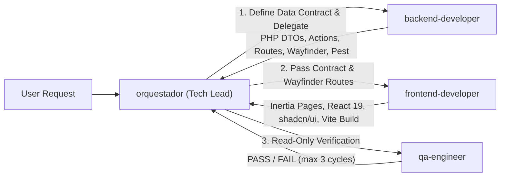
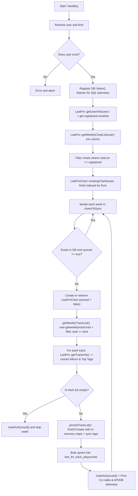
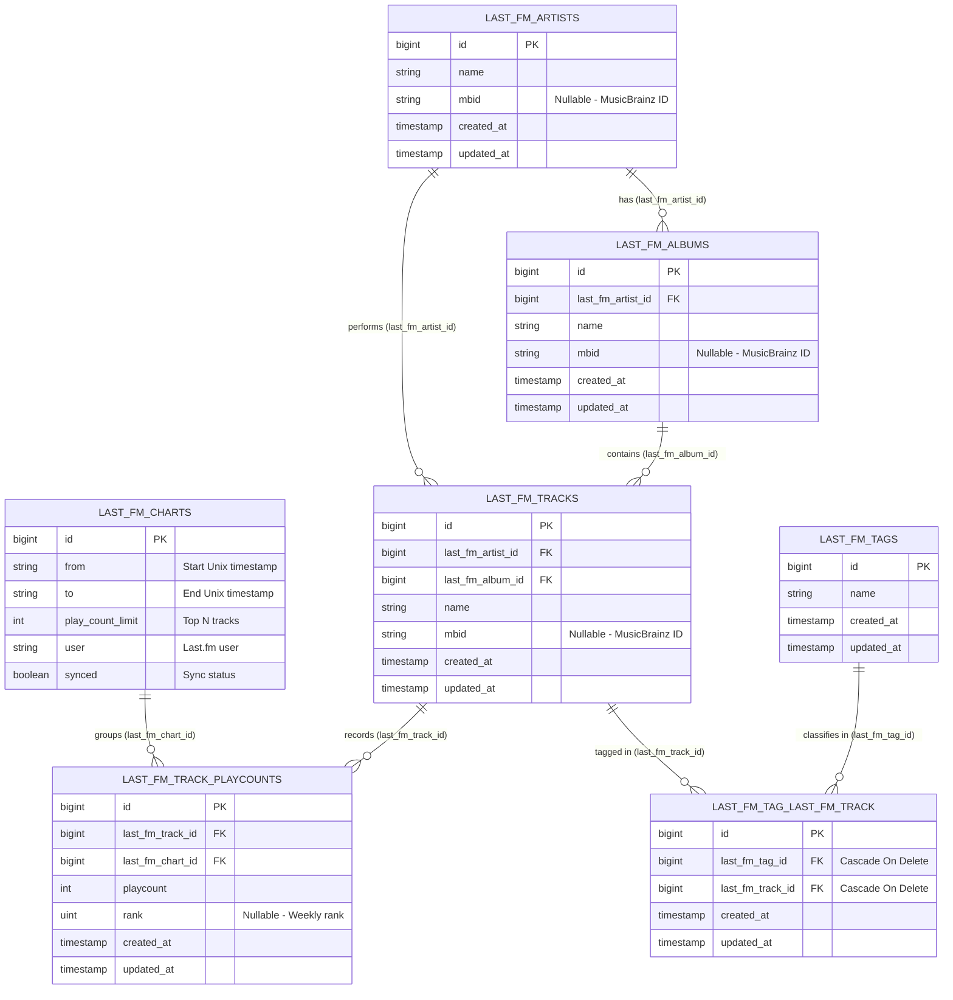
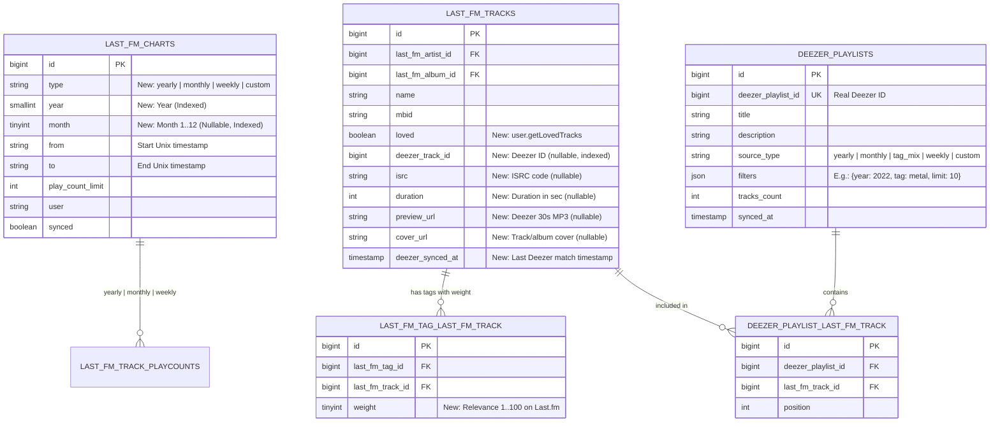
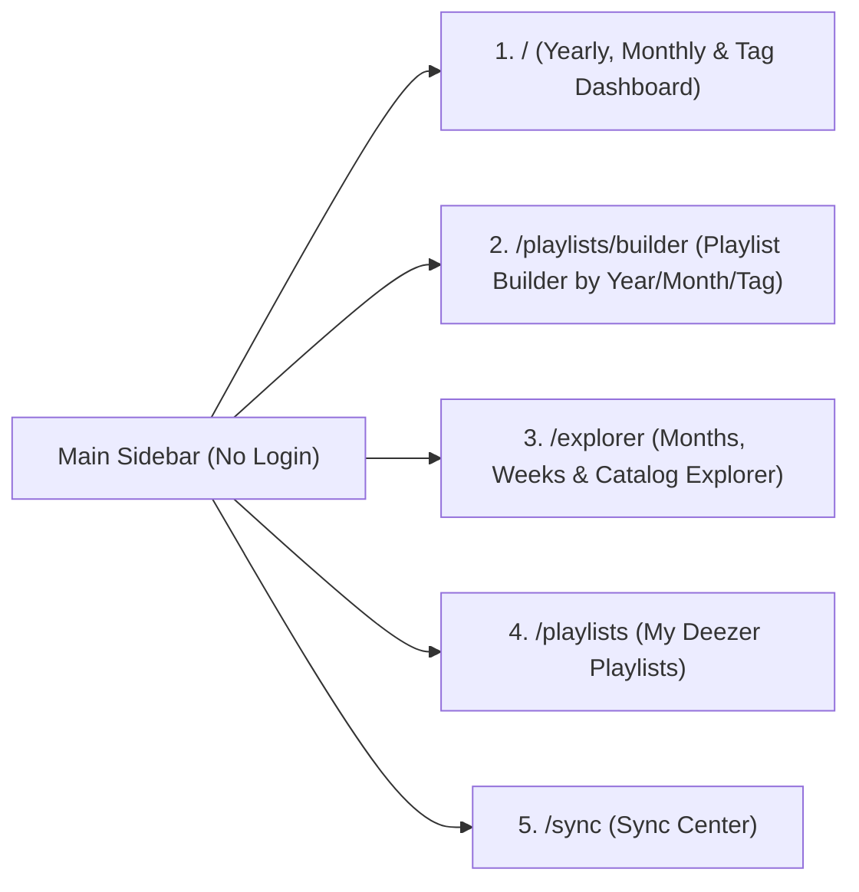

# LastFM v3 — Technical Documentation & Data Model

Application built on **Laravel 13 (PHP 8.3+)** focused on extracting, enriching, and locally persisting **Last.fm** weekly listening history (*weekly track charts*), with persistent API response caching, in-memory deduplication, and performance telemetry (API + SQL).

---

## 0. AI Agent Architecture & Workflow (`.agents/`)

Alongside [`AGENTS.md`](AGENTS.md), the [`.agents/`](.agents) directory configures a multi-agent development workflow tailored to `lastfm_v3` (Laravel 13 + Inertia v3 + React 19 + Tailwind v4). It defines specialized roles, domain guardrails, framework skills, and MCP tooling so changes follow the project's architecture and never violate database or API constraints.

### Directory Structure

| Path | Purpose |
| :--- | :--- |
| [`.agents/agents/`](.agents/agents) | Role definitions, tool permissions, and scope boundaries for each specialized agent. |
| [`.agents/rules/`](.agents/rules) | Domain source-of-truth rules (`trigger: model_decision`) consulted before planning or editing code. |
| [`.agents/skills/`](.agents/skills) | Framework-specific skill guides (Laravel, Inertia React, Tailwind, Pest, Wayfinder, convention inference). |
| [`.agents/mcp_config.json`](.agents/mcp_config.json) | MCP server configuration registering `laravel-boost` (`php artisan boost:mcp`). |

### How the Agents Work Together



### Agent Roles & Responsibilities

1. **[`orquestador`](.agents/agents/orquestador.md)** — *Tech Lead & Full-Stack Architect (`mainAgent: true`)*
   - **What it does:** Receives the user's request, reads [`.agents/rules/lastfm-domain.md`](.agents/rules/lastfm-domain.md) and existing code, clarifies any ambiguity (data scope, user, `play_count_limit`), breaks the work into numbered tasks, and defines a single **backend ↔ frontend data contract** (PHP DTOs, Inertia page name, exact TypeScript prop types, and named Wayfinder routes).
   - **How it operates:** **Never writes or edits application files.** It delegates sequentially (`backend-developer` → `frontend-developer` → `qa-engineer`), requests explicit user approval before restricted commands (`migrate`, `db:seed`, `lastfm:sync-weekly`, `cache:clear`, reading `.env`), validates final diffs against the contract, and routes any QA failures back to the responsible agent (up to 3 cycles).

2. **[`backend-developer`](.agents/agents/backend-developer.md)** — *Laravel 13 / PHP 8.3+ Specialist*
   - **What it does:** Implements the server-side portion of the data contract: Eloquent models, reversible migrations, `final readonly` DTOs (`app/Data/`), `final` Actions (`app/Actions/`), Services (`app/Services/`), thin Inertia controllers (`app/Http/Controllers/`), HTTP clients (`app/Clients/`), named routes (`routes/`), and Pest tests (`tests/`).
   - **Scope & rules:** Restricted to `app/`, `database/migrations/`, `database/factories/`, `routes/`, `config/`, and `tests/` (only touches [`ResetLastFm.php`](database/seeders/ResetLastFm.php) when a migration adds or drops a domain table). Never touches `resources/js/`, `.env`, or `composer.json` without approval. Uses `Http::fake()` in all tests and runs `vendor/bin/rector`, `vendor/bin/pint`, `php artisan wayfinder:generate`, and `php artisan test` before handing back to the orchestrator.

3. **[`frontend-developer`](.agents/agents/frontend-developer.md)** — *React 19 + Inertia v3 + Tailwind v4 Specialist*
   - **What it does:** Builds responsive, light/dark-mode Inertia pages (`resources/js/pages/`), layouts (`resources/js/layouts/`), domain components (`resources/js/components/`), hooks, and TypeScript interfaces (`resources/js/types/`) strictly matching the orchestrator's data contract and Wayfinder routes (`@/routes`).
   - **Scope & rules:** Activates `modern-web-guidance` before implementing UI, reuses existing shadcn/ui primitives from `resources/js/components/ui/` (composed with `cn()`), and uses `<Deferred>` + `Skeleton` for deferred props. Never touches backend files or manually edits generated `resources/js/routes/**` or `resources/js/wayfinder/**`. Runs `npx eslint resources/js --fix`, `npx tsc --noEmit`, and `npm run build` before handing back.

4. **[`qa-engineer`](.agents/agents/qa-engineer.md)** — *Read-Only Quality & Contract Verifier (`model: flash`)*
   - **What it does:** Independently verifies everything produced by `backend-developer` and `frontend-developer` and issues a structured `PASS | FAIL` verdict with literal error evidence, classifying failures as regressions or pre-existing issues.
   - **Scope & rules:** Strictly read-only — never creates, edits, deletes, formats, or builds files, and never runs DB/API-mutating commands. Executes `git status --short`, `git diff --stat`, `php artisan test` (SQLite `:memory:`), `npx tsc --noEmit`, and `php artisan route:list --except-vendor`, and audits the diff for contract parity, `user` + `play_count_limit` filtering, `Http::fake()` usage, and absence of hardcoded URLs or unauthorized dependencies.

### Domain Rules, Skills & MCP

- **Domain Guardrails ([`lastfm-domain.md`](.agents/rules/lastfm-domain.md))**: Acts as the single source of truth for `LASTFM_*` env/config keys, the 7 `last_fm_*` tables and unique indexes (including filtering charts by `user` + `play_count_limit` + `viral_limit`), `LastFmClient` permanent caching, `ResetLastFm` seeder rules, and **restricted commands** (`db:seed`, `migrate*`, `lastfm:sync-weekly`, `cache:clear`, reading `.env`) that require explicit user approval.
- **Installed Skills ([`.agents/skills/`](.agents/skills))**:
  - `laravel-best-practices` — Laravel architecture, Eloquent, queries, caching, security, and validation patterns.
  - `inertia-react-development` — Inertia.js v3 React patterns (`<Link>`, `<Form>`, `useForm`, `<Deferred>`, polling, etc.).
  - `tailwindcss-development` — Tailwind CSS v4 utilities, responsive grids, and dark mode tokens.
  - `testing-best-practices` — Pest test design, isolation, assertions, and coverage review.
  - `wayfinder-development` — Typed route/controller imports from `@/actions` and `@/routes`.
  - `infer-conventions` — On-demand convention analysis (`disable-model-invocation: true`) that records project rules via Boost.
- **MCP Integration ([`mcp_config.json`](.agents/mcp_config.json))**: Exposes `laravel-boost` (`php artisan boost:mcp`) so agents can inspect database schemas, run read-only queries, check logs, and search version-accurate Laravel ecosystem documentation.

---

## 1. Technical Analysis of `LastFmSyncWeekly`

**File:** [`app/Console/Commands/LastFmSyncWeekly.php`](app/Console/Commands/LastFmSyncWeekly.php)

### 1.1 Command Definition & Signature
The command uses native PHP 8 / Laravel 13 attributes to declare its signature and description:

```php
#[Signature('lastfm:sync-weekly {user?} {--limit=}')]
#[Description('Sync weekly data from Last.fm')]
```

- **`{user?}`** *(optional)*: Last.fm username. If omitted, it resolves via `LastFm::getDefaultUser()` (`config('services.lastfm.user')`, defaults to `'svigle'`).
- **`{--limit=}`** *(optional)*: Maximum number of tracks (*top ranks*) to sync per week. If omitted, it uses `config('services.lastfm.top_songs')` (defaults to `20`).

```bash
# Run with default values
php artisan lastfm:sync-weekly

# Run specifying a user and top tracks limit per week
php artisan lastfm:sync-weekly svigle --limit=50
```

---

### 1.2 In-Memory Cache Structures (Runtime Memoization)
To avoid the $N+1$ database problem when processing hundreds of weeks where the same artists, albums, tracks, and tags appear repeatedly, the command maintains 5 private associative dictionaries in memory for the lifetime of the CLI process:

| Property | Key Format | Stored Value | Purpose |
| :--- | :--- | :--- | :--- |
| `$artistIdMap` | `"{artist}\|{artist_mbid}"` | `int` (`last_fm_artists.id`) | Prevents calling `LastFmArtist::firstOrCreate()` more than once per artist. |
| `$albumIdMap` | `"{artist_id}\|{album}"` | `int` (`last_fm_albums.id`) | Avoids querying/creating the same album for an already-resolved artist. |
| `$trackIdMap` | `"{artist_id}\|{album_id}\|{track}"` | `int` (`last_fm_tracks.id`) | Resolves in $O(1)$ the ID of a track seen in previous weeks. |
| `$tagIdMap` | `"{tag_name}"` | `int` (`last_fm_tags.id`) | Avoids repeated `firstOrCreate()` calls on common music tags (*rock*, *indie*, etc.). |
| `$trackTagsSyncedMap` | `"{track_id}"` | `bool` (`true`) | Ensures `syncWithoutDetaching()` on the tag pivot table runs only the first time the track appears in the run. |

---

### 1.3 Step-by-Step Execution Flow



1. **Database Instrumentation (`DB::listen`)**:
   Before starting, attaches a listener to the database engine that intercepts every executed SQL statement, extracts the leading token (`SELECT`, `INSERT`, `UPDATE`, etc.), and accumulates counters in `$dbQueries` for performance diagnostics.
2. **User Timeframe Validation (`LastFm::getUserInfo`)**:
   Queries Last.fm's `user.getinfo` method and extracts `registered.unixtime`. This avoids requesting empty historical weeks prior to the user's account creation.
3. **Fetching the Weekly Chart Catalog (`LastFm::getWeeklyChartList`)**:
   Queries `user.getweeklychartlist` forcing `cache: false` to always obtain the latest list of weekly ranges (`from` and `to` Unix timestamps) and filters out ranges where `to < $registered`.
4. **Idempotency Control (`LastFmChart::existingCharts`)**:
   Loads all previously registered weeks for the `(user, play_count_limit)` pair in a single query and indexes them by the `from` timestamp. In the main loop:
   - If the week exists and `$lastFmChart->synced === true`, it is skipped with zero HTTP calls or DB writes.
   - If it does not exist, a record is inserted into `last_fm_charts` with `synced = false` via `LastFmChart::forChart()`.
5. **Extraction & Enrichment (`getWeeklyTrackList`)**:
   - Calls `LastFm::getWeeklyTrackList($user, $from, $to)` (`user.getweeklytrackchart`).
   - Filters results to keep only tracks with `@attr.rank <= $limit`.
   - Since Last.fm's weekly chart endpoint **does not include album or tag metadata**, for each filtered track it performs an enrichment call to `LastFm::getTrackInfo($artist, $trackName)` (`track.getinfo`), extracting:
     - `toptags.tag` (list of track tags).
     - `album.title` (falling back to `'Unknown Album'`) and `album.mbid`.
6. **Batch Transactional Persistence (`persistTrackList`)**:
   - Resolves or creates **Artist → Album → Track** in cascade using private methods `getCachedArtistId()`, `getCachedAlbumId()`, and `getCachedTrack()`.
   - Syncs the many-to-many tag relationship (`tags()->syncWithoutDetaching($tagIds)`) only once per track during the execution.
   - Builds the `$playcountsToInsert` array and executes a single bulk `LastFmTrackPlaycounts::upsert()` per week.
   - Marks the week as synced (`$lastFmChart->markAsSynced()`) and prints the track list to the console along with HTTP call and SQL query summaries.

---

## 2. Project Dependencies

Below are all project-owned PHP files that `LastFmSyncWeekly` directly or indirectly depends on:

### 2.1 HTTP Client Layer, Facade & Service Provider

#### [`app/Clients/LastFmClient.php`](app/Clients/LastFmClient.php)
HTTP client responsible for all communication with the Audioscrobbler / Last.fm 2.0 API (`http://ws.audioscrobbler.com/2.0/`).
- **Configuration**: Reads `url`, `key`, and `user` from [`config/services.php`](config/services.php) (`services.lastfm.*`).
- **Permanent Cache (`resolve`)**: All requests go through `resolve()`, which builds a deterministic key `'lfm.' . md5($method . serialize($params))` and wraps the call in `Cache::rememberForever()`.
  - If a track or artist was queried in the past, `getTrackInfo()` or `getWeeklyTrackList()` are served directly from local cache without hitting the network.
  - When `$cache = false` is passed (used in `getWeeklyChartList()`), it invalidates the key via `Cache::forget()` before refreshing.
- **HTTP Telemetry (`$callLog`)**: Only on a cache miss when `getRequest()` is invoked are the method and parameters recorded in the static `self::$callLog` array. Exposes `getCallCount()`, `getCallLog()`, and `resetCallLog()`.
- **Implemented endpoints**:
  - `getUserInfo(string $user)` → `user.getinfo`
  - `getWeeklyChartList(string $user)` → `user.getweeklychartlist`
  - `getWeeklyTrackList(string $user, int $from, int $to)` → `user.getweeklytrackchart`
  - `getTrackInfo(string $artist, string $track)` → `track.getinfo`
  - `getAlbumInfo(string $artist, string $album)` → `album.getinfo`

#### [`app/Facades/LastFm.php`](app/Facades/LastFm.php)
Laravel Facade whose `getFacadeAccessor()` points to `App\Clients\LastFmClient::class`, allowing static client calls (`LastFm::getUserInfo(...)`, etc.).

#### [`app/Providers/LastFmServiceProvider.php`](app/Providers/LastFmServiceProvider.php) and [`config/services.php`](config/services.php)
- `LastFmServiceProvider` is registered in [`bootstrap/providers.php`](bootstrap/providers.php) to bind `LastFmClient` as a *singleton* in the IoC container.
- `config/services.php` centralizes environment variables:
  - `LASTFM_API_KEY` (`services.lastfm.key`)
  - `LASTFM_USER` (`services.lastfm.user`, default: `'svigle'`)
  - `LASTFM_API_URL` (`services.lastfm.url`, default: `'http://ws.audioscrobbler.com/2.0/'`)
  - `LASTFM_TOP_SONGS` (`services.lastfm.top_songs`, default: `20`)

---

### 2.2 Eloquent Models Layer (`app/Models/`)

- **[`app/Models/LastFmChart.php`](app/Models/LastFmChart.php)**:
  Represents a weekly listening period for a given user and track limit.
  - Disables `timestamps` (`#[WithoutTimestamps]`).
  - Casts `from` and `to` (stored as Unix timestamp strings) to `Carbon` objects formatted as `datetime:Y-m-d H:i:s`.
  - Static query/creation helpers: `existingCharts(string $user, int $limit)` (indexes results by `$chart->from->timestamp`) and `forChart(...)`.
  - State method: `markAsSynced()`.
  - Relationships: `trackPlaycounts()` (`HasMany`) and `tracks()` (`HasManyThrough`).
- **[`app/Models/LastFmArtist.php`](app/Models/LastFmArtist.php)**:
  Represents a music artist (`name`, `mbid`). Defines `albums()` (`HasMany`) and `tracks()` (`HasMany`).
- **[`app/Models/LastFmAlbum.php`](app/Models/LastFmAlbum.php)**:
  Represents an album (`last_fm_artist_id`, `name`, `mbid`). Defines `artist()` (`BelongsTo`) and `tracks()` (`HasMany`).
- **[`app/Models/LastFmTrack.php`](app/Models/LastFmTrack.php)**:
  Represents a unique track per artist and album (`last_fm_artist_id`, `last_fm_album_id`, `name`, `mbid`).
  - Includes local scope `#[Scope] byArtistName(string $artistName)`.
  - Relationships: `artist()` (`BelongsTo`), `album()` (`BelongsTo`), `playcounts()` (`HasMany`), and `tags()` (`BelongsToMany` with `LastFmTag`).
- **[`app/Models/LastFmTag.php`](app/Models/LastFmTag.php)**:
  Genre/tag catalog (`name`). Relationship: `tracks()` (`BelongsToMany` with `LastFmTrack`).
- **[`app/Models/LastFmTrackPlaycounts.php`](app/Models/LastFmTrackPlaycounts.php)**:
  Associative entity recording how many times (`playcount`) and at what position (`rank`) a track (`last_fm_track_id`) was played within a specific week (`last_fm_chart_id`).

---

## 3. Database Model (`database/`)

### 3.1 Entity-Relationship Diagram (ERD)



---

### 3.2 Migration Details (`database/migrations/`)

#### Last.fm Domain
1. **`last_fm_charts`**
   - [`2026_04_13_203621_create_last_fm_charts_table.php`](database/migrations/2026_04_13_203621_create_last_fm_charts_table.php): Creates the table with `id`, `from` (`string`, default `''`), `to` (`string`, default `''`), `user` (`string`, default `''`), `synced` (`boolean`, default `false`). Does not use `timestamps`.
   - [`2026_04_16_194635_last_fm_charts_play_count_limit.php`](database/migrations/2026_04_16_194635_last_fm_charts_play_count_limit.php): Adds the `play_count_limit` (`integer`) column after `to`.
2. **`last_fm_artists`**
   - [`2026_04_16_202718_create_last_fm_artists_table.php`](database/migrations/2026_04_16_202718_create_last_fm_artists_table.php): Creates `id`, `name` (`string`), `mbid` (`string`, nullable), and `timestamps()`.
3. **`last_fm_albums`**
   - [`2026_04_19_225629_create_last_fm_albums_table.php`](database/migrations/2026_04_19_225629_create_last_fm_albums_table.php): Creates `id`, `last_fm_artist_id` (`foreignIdFor(LastFmArtist::class)`), `name` (`string`), `mbid` (`string`, nullable), and `timestamps()`.
4. **`last_fm_tracks`**
   - [`2026_04_16_202751_create_last_fm_tracks_table.php`](database/migrations/2026_04_16_202751_create_last_fm_tracks_table.php): Creates `id`, `last_fm_artist_id` (`foreignIdFor(LastFmArtist::class)`), `name` (`string`), `mbid` (`string`, nullable), and `timestamps()`.
   - [`2026_04_19_230958_add_album_to_track_last_fm.php`](database/migrations/2026_04_19_230958_add_album_to_track_last_fm.php): Adds `last_fm_album_id` (`foreignIdFor(LastFmAlbum::class)`) after `last_fm_artist_id`.
5. **`last_fm_track_playcounts`**
   - [`2026_04_16_204234_create_last_fm_track_playcounts_table.php`](database/migrations/2026_04_16_204234_create_last_fm_track_playcounts_table.php): Creates `id`, `last_fm_track_id` (`foreignIdFor(LastFmTrack::class)`), `last_fm_chart_id` (`foreignIdFor(LastFmChart::class)`), `playcount` (`integer`), and `timestamps()`.
   - [`2026_04_17_184026_add_rank_last_fm_track_playcounts.php`](database/migrations/2026_04_17_184026_add_rank_last_fm_track_playcounts.php): Adds `rank` (`unsignedInteger`, nullable) after `playcount`.
6. **`last_fm_tags` and pivot table `last_fm_tag_last_fm_track`**
   - [`2026_06_15_030723_create_last_fm_tags_table.php`](database/migrations/2026_06_15_030723_create_last_fm_tags_table.php): Creates `id`, `name` (`string`), and `timestamps()`.
   - [`2026_06_15_031109_create_last_fm_tag_last_fm_track_table.php`](database/migrations/2026_06_15_031109_create_last_fm_tag_last_fm_track_table.php): Creates the pivot table with explicit foreign keys (`constrained()->cascadeOnDelete()`) referencing `last_fm_tags` and `last_fm_tracks`.

#### Infrastructure & Authentication
- [`0001_01_01_000001_create_cache_table.php`](database/migrations/0001_01_01_000001_create_cache_table.php): Creates the `cache` table where `LastFmClient` permanently stores (`Cache::rememberForever`) Last.fm JSON payloads under the `lfm.<md5>` prefix.
- [`0001_01_01_000000_create_users_table.php`](database/migrations/0001_01_01_000000_create_users_table.php) and [`2026_04_25_190307_add_two_factor_columns_to_users_table.php`](database/migrations/2026_04_25_190307_add_two_factor_columns_to_users_table.php): Users, sessions, and 2FA tables (Laravel Fortify).
- [`0001_01_01_000002_create_jobs_table.php`](database/migrations/0001_01_01_000002_create_jobs_table.php): Queue tables (`jobs`, `job_batches`, `failed_jobs`).

### 3.3 Seeders (`database/seeders/`)
- **[`ResetLastFm.php`](database/seeders/ResetLastFm.php)**: Utility seeder invoked by [`DatabaseSeeder.php`](database/seeders/DatabaseSeeder.php) that temporarily disables foreign key constraints (`Schema::withoutForeignKeyConstraints`) and runs `truncate()` across all 7 Last.fm domain tables (`last_fm_charts`, `last_fm_artists`, `last_fm_tracks`, `last_fm_track_playcounts`, `last_fm_albums`, `last_fm_tags`, and `last_fm_tag_last_fm_track`), leaving the `cache` table intact so the relational database can be repopulated in seconds without calling the Last.fm API again.

---

## 4. Technical Audit & Architectural Notes

During cross-validation between `LastFmSyncWeekly`, Eloquent models, and migrations in `database/`, the following technical points were identified:

1. **Missing Unique Index on `last_fm_track_playcounts` for `upsert()`**:
   - In [`LastFmSyncWeekly.php`](app/Console/Commands/LastFmSyncWeekly.php#L270-L274), the following is executed:
     ```php
     LastFmTrackPlaycounts::upsert(
         $playcountsToInsert,
         ['last_fm_chart_id', 'last_fm_track_id'],
         ['playcount', 'rank']
     );
     ```
   - The `last_fm_track_playcounts` table does not define `$table->unique(['last_fm_chart_id', 'last_fm_track_id'])`. On engines like SQLite or PostgreSQL this triggers an SQL error in `ON CONFLICT`, and on MySQL/MariaDB it prevents `ON DUPLICATE KEY UPDATE` from detecting collisions on that pair, inserting duplicate rows if a partial week is re-run.
2. **Incorrect Namespace in `LastFmServiceProvider`**:
   - In [`app/Providers/LastFmServiceProvider.php`](app/Providers/LastFmServiceProvider.php#L7), `App\Services\LastFmClient` (non-existent) is imported instead of `App\Clients\LastFmClient`. As a result, the singleton registered in the provider is never used and Laravel instantiates `App\Clients\LastFmClient` as a fresh class via auto-wiring every time the Facade resolves it.
3. **Implicit Foreign Keys in `BelongsTo` and `HasManyThrough` Relationships**:
   - In [`LastFmAlbum::artist()`](app/Models/LastFmAlbum.php#L17-L20), [`LastFmTrack::artist()`](app/Models/LastFmTrack.php#L24-L27), and [`LastFmTrack::album()`](app/Models/LastFmTrack.php#L19-L22), Eloquent infers the foreign key name from the method name (`artist_id` and `album_id`), whereas the actual database columns are `last_fm_artist_id` and `last_fm_album_id`. The second parameter must be specified explicitly (`$this->belongsTo(LastFmArtist::class, 'last_fm_artist_id')`).
   - In [`LastFmChart::tracks()`](app/Models/LastFmChart.php#L49-L52), the `hasManyThrough` relationship requires explicit keys or should be replaced with `belongsToMany(LastFmTrack::class, 'last_fm_track_playcounts')->withPivot(['playcount', 'rank'])`.
4. **Initialization of `$tags` in `getWeeklyTrackList()`**:
   - In [`LastFmSyncWeekly.php`](app/Console/Commands/LastFmSyncWeekly.php#L213-L233), `$tags` is only defined inside `if ($artist && $trackName)`. If a chart entry ever arrived without an artist or track name, `'tags' => $tags->toArray()` would throw an undefined variable exception.

---

## 5. Roadmap & Evolution Plan (Priority #1: Monthly/Yearly Stats & Tag Engine + Deezer + Zero-Login Frontend)

This section documents the detailed technical plan, prioritizing as the **first critical deliverable** the **monthly, yearly, and tag/genre statistics engine** (e.g., *"Top 10 Metal tracks of 2022"*), followed by the **Deezer** playlist generator (`https://developers.deezer.com/api`) and the zero-login **React 19 + Inertia v3** frontend.

---

### 5.1 Phase 0: Hardening the Current Foundation (Mandatory Fixes)

1. **Unique index on `last_fm_track_playcounts`**: Add `$table->unique(['last_fm_chart_id', 'last_fm_track_id'])` in a migration so `LastFmTrackPlaycounts::upsert()` is idempotent and neither duplicates rows nor fails on SQLite/PostgreSQL.
2. **Fix [`LastFmServiceProvider.php`](app/Providers/LastFmServiceProvider.php)**: Change `use App\Services\LastFmClient;` to `use App\Clients\LastFmClient;`.
3. **Fix foreign keys in Eloquent Models**: Specify `'last_fm_artist_id'` and `'last_fm_album_id'` in the `belongsTo()` calls of [`LastFmAlbum`](app/Models/LastFmAlbum.php) and [`LastFmTrack`](app/Models/LastFmTrack.php), and replace `LastFmChart::tracks()` with `belongsToMany(LastFmTrack::class, 'last_fm_track_playcounts')->withPivot(['playcount', 'rank'])`.
4. **Safe initialization of `$tags` and in-RAM caching of `getTrackInfo`**: Declare `$tags = collect();` before the conditional in [`LastFmSyncWeekly::getWeeklyTrackList()`](app/Console/Commands/LastFmSyncWeekly.php#L210-L221) and memoize `LastFm::getTrackInfo()` responses in an in-memory `$this->trackInfoMap` array so the same track is not queried or deserialized from the `cache` table dozens of times as it repeats across years.

---

### 5.2 Phase 1 (PRIORITY #1): Monthly, Yearly & Tag Statistics Architecture using `user.getWeeklyTrackChart`

#### 1. The Secret of `user.getWeeklyTrackChart` (Live-Tested Against the Last.fm API)
Although the official [`user.getWeeklyTrackChart`](https://www.last.fm/api/show/user.getWeeklyTrackChart) documentation suggests using the 7-day ranges from `user.getWeeklyChartList`, **internally the endpoint accepts ANY arbitrary pair of Unix timestamps (`from` and `to`) plus an optional `limit` parameter**:

- **Exact Yearly Slice (1 HTTP request per year)**:
  Sending `from = 1640995200` (`2022-01-01 00:00:00 UTC`) and `to = 1672531199` (`2022-12-31 23:59:59 UTC`), Last.fm computes and returns in a single call up to the **top 1,000 most-played tracks of all of 2022** with their exact yearly `playcount` and `rank`.
- **Exact Monthly Slice (1 HTTP request per month)**:
  Sending `from = 1651363200` (`2022-05-01 00:00:00 UTC`) and `to = 1654041599` (`2022-05-31 23:59:59 UTC`), it returns in a single call the exact ranking for **May 2022** (with no split-week issues or weekly-boundary bias).
- **`limit` parameter supported by the API**:
  In addition to local filtering, `user.getweeklytrackchart` accepts `limit=N` in query params to cap the payload at the source, or without `limit` to receive up to 1,000 tracks for the period.

#### 2. Minimal Adaptation in `last_fm_charts`: `type` Column (`yearly` | `monthly` | `weekly` | `custom`)
Your current `last_fm_charts` table (`from`, `to`, `play_count_limit`, `user`, `synced`) **already has the ideal structure** to store full years, months, and weeks alike:
- Simply add the `type` column (`string`, indexed, default `'weekly'`, values `'yearly'`, `'monthly'`, `'weekly'`, `'custom'`) and optionally `year` (`smallint`) and `month` (`tinyint`, nullable) for readable queries.
- Thus, the year `2022` is simply a record in `last_fm_charts` with:
  - `type = 'yearly'`, `year = 2022`, `month = null`, `from = '1640995200'`, `to = '1672531199'`.
- And May `2022` is a record in `last_fm_charts` with:
  - `type = 'monthly'`, `year = 2022`, `month = 5`, `from = '1651363200'`, `to = '1654041599'`.

#### 3. Solving the Complex Tag Case: *"Top 10 Metal Tracks of 2022"*
Because `user.getWeeklyTrackChart` gives us up to **1,000 tracks from 2022 in a single call**, answering *"Top 10 Metal of 2022"* no longer requires summing weeks: we just filter the `2022` yearly chart's tracks by their tags.
To make tag filtering rock-solid, we solve 3 real-world Last.fm metadata issues:

1. **Requesting a Top 10 for a specific Tag in a Year requires a wide `play_count_limit` for that Year**:
   If your top 50 tracks of 2022 were K-Pop or Indie and Metal only starts appearing at #55 for the year, syncing 2022 with `--limit=20` would miss those 10 Metal tracks.
   - **Solution**: For `yearly` and `monthly` charts, we sync with a wide limit (e.g. `--limit=250` or `--limit=500`), and optimize [`LastFmSyncWeekly`](app/Console/Commands/LastFmSyncWeekly.php) so it **only queries `LastFm::getTrackInfo()` when the track does not yet exist in `last_fm_tracks`**.
2. **Subgenre Fragmentation (`metal` vs `thrash metal`, `progressive metal`, `heavy metal`, `death metal`)**:
   - **Solution**: **Tag Family** matching (`tg.name = 'metal' OR tg.name LIKE '%metal%'`) + a `weight` column (`unsignedTinyInteger`, default `100`) on `last_fm_tag_last_fm_track` (storing the `count` `1..100` returned by `track.getInfo` in `toptags.tag`) to discard irrelevant tags (`weight < 20`).
3. **Tracks Missing Tags in `track.getInfo`**:
   When an album track returns an empty `toptags.tag = []` in `track.getInfo`, the syncer automatically falls back to **`artist.getTopTags`** (cached once per artist) and inherits the artist's Top 5 tags onto the track.

#### 4. Direct SQL Query on the Yearly / Monthly Chart (Zero Heavy Sums, Zero Duplicates)
Once the 2022 yearly chart is synced in `last_fm_charts`, getting *"Top 10 Metal tracks of 2022"* is a direct query against that single `last_fm_chart_id` using `WHERE EXISTS` (to avoid duplicate rows when a track has multiple metal subgenres):

```sql
-- "Top 10 Metal tracks of 2022" reading directly from the 2022 Yearly Chart
SELECT
    tp.rank AS overall_year_rank,
    t.id,
    t.name AS track_name,
    ar.name AS artist_name,
    al.name AS album_name,
    tp.playcount
FROM last_fm_track_playcounts tp
INNER JOIN last_fm_charts c ON c.id = tp.last_fm_chart_id
INNER JOIN last_fm_tracks t ON t.id = tp.last_fm_track_id
INNER JOIN last_fm_artists ar ON ar.id = t.last_fm_artist_id
INNER JOIN last_fm_albums al ON al.id = t.last_fm_album_id
WHERE c.user = :user
  AND c.type = 'yearly'
  AND c.year = 2022 -- (Or c.type = 'monthly' AND c.year = 2022 AND c.month = 5)
  AND EXISTS (
      SELECT 1
      FROM last_fm_tag_last_fm_track tt
      INNER JOIN last_fm_tags tg ON tg.id = tt.last_fm_tag_id
      WHERE tt.last_fm_track_id = t.id
        AND tt.weight >= 20
        AND (tg.name = 'metal' OR tg.name LIKE '%metal%')
  )
ORDER BY tp.playcount DESC, tp.rank ASC
LIMIT 10;
```

---

### 5.3 Phase 2 (PRIORITY #1): Artisan Commands for Yearly/Monthly Sync & Tag Rankings

We will refactor the shared logic from [`LastFmSyncWeekly.php`](app/Console/Commands/LastFmSyncWeekly.php) into a reusable service/action (`App\Actions\SyncLastFmChartRange`) that accepts any `(user, from, to, type, limit)` and powers these commands:

#### 1. `lastfm:sync-yearly {user?} {--year=} {--limit=250} {--force}` *(Priority #1)*
- Computes the range from the user's registration year (`registered.unixtime`) to the current year (or only the specified `--year=2022`).
- For each year, generates exact timestamps `YYYY-01-01 00:00:00 UTC` and `YYYY-12-31 23:59:59 UTC`.
- Calls `LastFm::getWeeklyTrackList($user, $from, $to)` and persists the chart with `type = 'yearly'` and `year = YYYY`.
- Syncing 10 full years takes **only 10 calls to `user.getweeklytrackchart`**.

#### 2. `lastfm:sync-monthly {user?} {--year=} {--month=} {--limit=100} {--force}` *(Priority #1)*
- Iterates over the months of a year (`--year=2022`), a specific month (`--year=2022 --month=5`), or the user's entire monthly history.
- Computes `startOfMonth()->timestamp` and `endOfMonth()->timestamp` in UTC.
- Calls `LastFm::getWeeklyTrackList($user, $from, $to)` and persists the chart with `type = 'monthly'`, `year = YYYY`, `month = MM`.

#### 3. `lastfm:top {entity=tracks} {--year=} {--month=} {--from=} {--to=} {--tag=} {--exact-tag} {--artist=} {--limit=10}` *(Tag Query & Filter)*
Queries the yearly or monthly chart in the database (and if the requested year/month is not yet synced, syncs it on the fly automatically) applying the tag filter:

```bash
# Top 10 Metal tracks of 2022 (includes heavy metal, thrash metal, etc.)
php artisan lastfm:top tracks --year=2022 --tag="metal" --limit=10

# Top 20 tracks of May 2022
php artisan lastfm:top tracks --year=2022 --month=5 --limit=20

# Top 15 Rock en Español tracks of 2023
php artisan lastfm:top tracks --year=2023 --tag="rock en espanol" --limit=15

# Top 10 Metal artists or albums of 2022 (aggregated from the year's tracks)
php artisan lastfm:top artists --year=2022 --tag="metal" --limit=10
php artisan lastfm:top albums --year=2022 --tag="metal" --limit=10
```

#### 4. `lastfm:enrich-tags {--missing-only}` *(Artist Tag Inheritance & Cleanup)*
- For any track left without tags in `track.getInfo`, queries `artist.getTopTags` and inherits the artist's Top 5 tags with their `weight`, ensuring no track is excluded when filtering by genre.

#### 5. `lastfm:sync-weekly` and `lastfm:sync-loved`
- `lastfm:sync-weekly` remains available for weekly granularity (`type = 'weekly'`), sharing the same optimized engine.
- `lastfm:sync-loved` fetches `user.getLovedTracks` and marks `loved = true` on `last_fm_tracks`.

---

### 5.4 Phase 3: Schema Expansion & Deezer API Integration (`https://developers.deezer.com/api`)

Once `lastfm:top` resolves any yearly, monthly, or tag-filtered ranking, that same collection of tracks directly feeds playlist creation in **Deezer**.

#### 1. Full Schema of New Columns & Tables



#### 2. HTTP Client: `App\Clients\DeezerClient` and Facade `Deezer`
- **Configuration in [`config/services.php`](config/services.php)**: `url`, `app_id`, `secret`, `access_token`.
- **Rate Limit & Cache**: Respects Deezer's rate limit (**50 requests / 5 sec**) and caches search responses with `Cache::rememberForever('dz.' . md5(...))`.
- **Single-User Authentication**:
  - Catalog search (`GET /search/track`): **Public** (no token required).
  - Playlist creation (`POST /user/me/playlists`) and track insertion (`POST /playlist/{id}/tracks`): Uses `DEEZER_ACCESS_TOKEN` with `offline_access` scope (`expires=0`).

#### 3. Deezer Commands
- **`deezer:match-tracks {--year=} {--tag=} {--unmatched-only} {--limit=500}`**:
  Matches local tracks against `GET https://api.deezer.com/search/track` in 3 tiers (1: `artist + track + album`, 2: sanitized `artist + track` without `(Remastered)`, 3: open search with `similar_text >= 85%` validation) and stores `deezer_track_id`, `isrc`, `duration`, `preview_url`, and `cover_url`.
- **`deezer:make-playlist {title}`**:
  Connects `lastfm:top` filters directly to your Deezer account:
  ```bash
  # Create a Deezer playlist with Top 25 Metal tracks of 2022
  php artisan deezer:make-playlist "Metal 2022 - My Most Played" \
    --year=2022 \
    --tag="metal" \
    --limit=25
  ```

---

### 5.5 Phase 4: Detailed Front-End Architecture (Zero-Login, React 19 + Inertia v3 + Tailwind v4)

Built on the current stack ([`package.json`](package.json): **React 19**, **Inertia.js v3**, **Tailwind CSS v4**, **Radix UI / shadcn**, **Lucide Icons**, **Sonner**, **Wayfinder**) with all login screens removed.

#### 1. Zero-Login Setup (No Local Authentication)
- Direct routes in [`routes/web.php`](routes/web.php) with no `auth` or `verified` middleware.
- In [`resources/js/components/app-sidebar.tsx`](resources/js/components/app-sidebar.tsx), `<NavUser />` is replaced by `<SyncStatusFooter />` (active Last.fm user, synced weeks, and Deezer connection status).

#### 2. Main Views (Focused on Yearly, Monthly & Tag Analytics)



- **View 1: `/` — Yearly, Monthly & Genre Dashboard (`pages/dashboard/index.tsx`)**
  - **Main Period & Genre Selector (Sticky Header)**:
    - **Year** selector (`All`, `2026`, `2025`, ..., `2007`) or year range.
    - **Month** selector (`Full Year`, `January` .. `December`) for instant monthly zoom.
    - **Tag / Genre Family** search/selector (e.g., selecting `Metal` with a toggle *"Include subgenres like Thrash, Progressive, Death Metal"*).
  - **Dynamic KPI Cards**: Total plays for the selected year/month/tag, Unique Tracks, Unique Artists, #1 Genre of the period, and `%` of tracks ready on Deezer.
  - **Interactive Yearly / Monthly Matrix**:
    - Month-by-month bar chart (January to December of the chosen year) or year-by-year, plus genre percentage breakdown (`Top Tags` of the year).
  - **Rankings Bento Grid (With 1-Click "Create Playlist on Deezer" Button)**:
    - **Top Tracks of the Year/Month/Tag** (with cover art, 30s MP3 preview Play button, total plays, weeks on chart, and `#Peak` position).
    - **Top Artists of the Year/Month/Tag**.
    - **Top Albums of the Year/Month/Tag**.
    - **Subgenre Breakdown** (e.g., when filtering `Metal` in `2022`, shows how much `progressive metal`, `thrash metal`, `heavy metal`, etc. contributed).

- **View 2: `/playlists/builder` — Playlist Lab by Year, Month & Tags (`pages/playlists/builder.tsx`)**
  - **Left Column (Visual Rule Builder)**:
    - **Instant Presets**: *"Top 50 of a Year"*, *"Best of [Genre] in [Year]"* (e.g., Metal 2022), *"Monthly Recap (Year + Month)"*, *"Forgotten Gems of an Era"*, *"My Loved Tracks by Genre"*.
    - **Filters**: Year(s), Month(s), Tags & Tag Families (`INCLUDE` / `EXCLUDE`), Artists, **Anti-Monopoly Cap** (*"Max $N$ tracks per artist"*), minimum playcount, and playlist size (`10`, `25`, `50`, `100`).
  - **Right Column (Live Preview + Mini-Player + Publish to Deezer)**:
    - Live table with the exact tracks matching the rule, their playcount in that year/month, and their tags.
    - Button to match on the fly with Deezer any track missing a `deezer_track_id`.
    - **Footer Audio Mini-Player** to listen to Deezer 30s previews before exporting.
    - **"🚀 Create Playlist on Deezer"** button with an editable auto-generated name (e.g., `"Top Metal 2022 • Last.fm"`).

- **View 3: `/explorer` — Months, Weeks & Catalog Explorer (`pages/explorer/index.tsx`)**
  - Allows browsing a **Year → Month → Week** tree or searching directly across tracks/artists/tags, viewing which years and months each track charted, and manually fixing `deezer_track_id` if needed.

- **View 4: `/playlists` and `/sync` — Playlist History & Sync Center**
  - Manage and regenerate playlists pushed to Deezer (`/playlists`), and trigger sync and tag-enrichment commands from the web UI (`/sync`).
